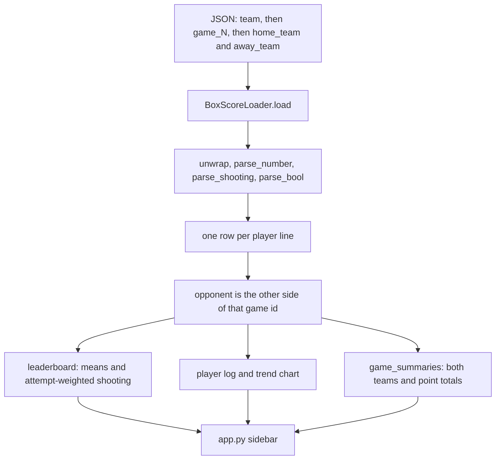
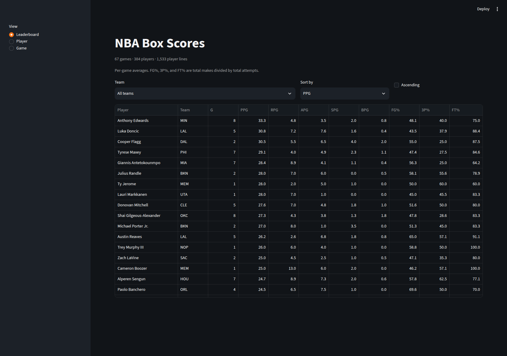
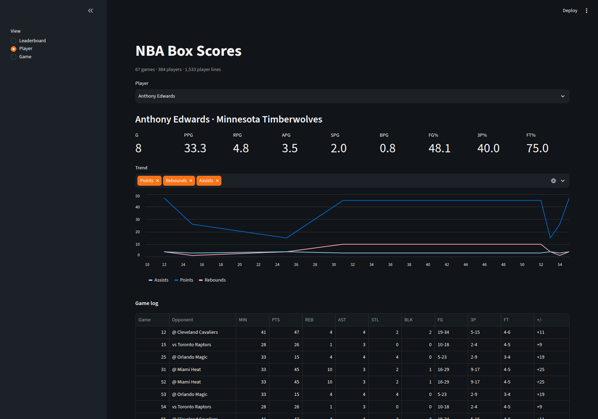
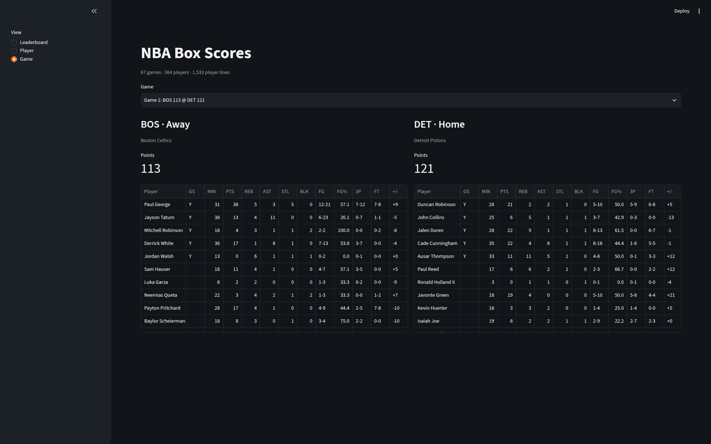

# NBA Box Score Explorer

Streamlit app that parses the nested box scores in `data/nba_box_scores.json` into a leaderboard, a player game log, and a single-game box score.

[](https://www.python.org/)
[](https://streamlit.io/)
[](LICENSE)

## Contents

- [Features](#features)
- [Quickstart](#quickstart)
- [Tech stack](#tech-stack)
- [Project structure](#project-structure)
- [Data pipeline](#data-pipeline)
- [Dataset](#dataset)
- [Screenshots](#screenshots)
- [Tests](#tests)
- [License](#license)

## Features

The sidebar has three views over the same parsed rows.

- **Leaderboard.** Per-game points, rebounds, assists, steals, and blocks, plus field-goal, three-point, and free-throw percentages. Filter by team name, sort from the control or a column header, and flip the order with Ascending. Shooting percentages are total makes divided by total attempts.
- **Player.** One player's games-played count and per-game line, a trend chart for any mix of points, rebounds, assists, steals, and blocks, and a game log with opponent, minutes, shooting lines, and plus-minus. The page opens on the highest points-per-game row in the file.
- **Game.** Both teams for one game id: abbreviations, full names, point totals, and each player's line. Starters are marked `Y` in the GS column and listed first.

Averages on the leaderboard and the player page share one rounding rule: half up, to a tenth. Anthony Edwards' points per game in this file are 33.25, so both views show 33.3.

## Quickstart

```bash
python3 -m pip install -r requirements.txt
python3 -m pytest
python3 -m streamlit run app.py
```

Streamlit prints a local URL, usually http://localhost:8501. Open that URL in a browser. The committed [`.streamlit/config.toml`](.streamlit/config.toml) uses a dark theme, turns usage stats off, and sets `headless = true`.

Use a virtual environment if you want these packages off your user install. `.venv/` is gitignored.

## Tech stack

| Piece | Where it shows up |
| --- | --- |
| Python 3 | `loader.py` and `app.py` |
| [Streamlit](https://streamlit.io/) `>=1.40` | Sidebar, tables, metrics, and the player trend chart |
| [pandas](https://pandas.pydata.org/) `>=2.2` | Leaderboard frame, game log, box-score tables, and the chart frame |
| [pytest](https://docs.pytest.org/) `>=8.0` | Parser tests. [`pytest.ini`](pytest.ini) puts the repo root on `pythonpath` |

Rows are loaded from [`data/nba_box_scores.json`](data/nba_box_scores.json) when the app starts.

## Project structure

```text
.
├── app.py                      # Streamlit UI (Dashboard)
├── loader.py                   # BoxScoreLoader
├── data/
│   └── nba_box_scores.json     # nested box scores
├── docs/
│   └── screenshots/            # the three views, from the running app
├── tests/
│   └── test_loader.py
├── .streamlit/
│   └── config.toml
├── .gitignore
├── pytest.ini
├── requirements.txt
├── LICENSE
└── README.md
```

## Data pipeline

`BoxScoreLoader.load` walks `{team abbreviation: {game_N: {home_team: [rows], away_team: [rows]}}}`. Counting stats are numeric strings. The shooting fields are named like percentages and stored as made-attempted strings such as `5-10`. After each row is parsed, the loader sets `opponent` from the other side of the same game id.

`leaderboard` groups by player and team abbreviation. `game_summaries` sums points for home and away. `app.py` renders one of the three sidebar views.



<details>
<summary>Parsing rules</summary>

- `unwrap` strips whitespace and matching quote layers. The tests cover `"'21'"` and a quoted name that itself contains an apostrophe.
- `parse_number` accepts integers, a leading `+`, and quoted values. Minutes or plus-minus of `--`, `DNP`, `NA`, `N/A`, or blank become missing. Other counting stats that fail to parse are stored as 0.
- `parse_shooting` splits `made-attempted`. The rate is missing when attempts are 0, including `0-0`.
- `Starter` accepts booleans and the strings `true`, `1`, and `yes`.
- Team abbreviations come from the name map in `loader.py`, including both `LA Clippers` and `Los Angeles Clippers`. This file uses `LA Clippers`. Every team string in the file is in the map. A name missing from the map is used as its own abbreviation.
- Shooting percentages on the leaderboard are `100 * makes / attempts` across that player's rows. The leaderboard test uses a 1-2 game and a 9-10 game and expects a field-goal percentage of `100 * 10 / 12`.
- Displayed averages go through `Decimal` with `ROUND_HALF_UP` to one decimal.

</details>

## Dataset

The file is the source of every figure below. It has no season label, date field, or collection note.

| | |
| --- | ---: |
| Player lines | 1,533 |
| Game ids | 67 (1 through 67) |
| Players | 384 |
| Teams in the rows | 29 |
| Top-level team keys | 20 |
| Starters | 10 on every game id |

The app caption is `67 games · 384 players · 1,533 player lines`. Games played on the leaderboard counts game ids.

`tests/test_loader.py` checks one real row: Duncan Robinson, game id 1, Detroit Pistons at home against the Boston Celtics, 21 points, 2 rebounds, 2 assists, 5-10 from the field, plus-minus +5, and a starter. The game view labels that id `Game 1: BOS 113 @ DET 121`. Two lines have minutes `--`, both Pacome Dadiet, and the loader stores those minutes as missing.

<details>
<summary>How the file is nested</summary>

Each game object sits under one team abbreviation. Ignoring `game_id`, 26 matchups are stored a second time under the other team, and 15 game ids appear once (6, 11, 13, 14, 22, 27, 30, 34, 41, 43, 47, 48, 60, 61, 65). That is 41 distinct box scores. The loader keeps all 67 ids, so a repeated box score counts twice in games played and shows up twice in a game log.

Two examples: ids 1 and 4 are both Boston at Detroit, 113–121, and ids 44 and 67 are both Golden State at Denver, 134–114.

Game objects under each top-level key:

| Key | Games | Key | Games |
| --- | ---: | --- | ---: |
| ATL | 4 | MIA | 4 |
| BOS | 3 | MIN | 4 |
| CHA | 4 | NYK | 3 |
| CLE | 3 | OKC | 4 |
| DEN | 3 | ORL | 3 |
| DET | 3 | PHI | 4 |
| GSW | 4 | PHX | 3 |
| HOU | 4 | POR | 2 |
| LAC | 3 | SAS | 3 |
| LAL | 3 | TOR | 3 |

Those 20 keys sum to 67 game objects.

</details>

## Screenshots

These are the three views from `python3 -m streamlit run app.py` on the bundled file.

### Leaderboard



Default sort is points per game, high to low. The team filter lists full names. The Team column is the abbreviation.

### Player



The trend x-axis is game id. In this log, games 31 and 52 are the same Minnesota at Miami box score stored under two ids, and the same is true of the other repeated lines. The chart follows the file.

### Game



Home is Detroit, 121. Away is Boston, 113. Duncan Robinson's line matches the row the tests lock in.

## Tests

```bash
python3 -m pytest
```

`tests/test_loader.py` has seven tests:

| Test | What it locks in |
| --- | --- |
| `test_unwrap_strips_extra_quotes` | Quote layers come off; an apostrophe inside a name stays. |
| `test_parse_number_and_plus_minus` | Quoted numbers, a leading `+`, negatives, and `--`. |
| `test_parse_shooting_made_attempted` | `5-10` is 5 makes, 10 attempts, rate 0.5. `0-0` has no rate. |
| `test_parse_row_accepts_quoted_strings` | A fully quoted Duncan Robinson row, including starter and `DET`. |
| `test_leaderboard_uses_attempt_weighted_percentages` | 1-2 and 9-10 aggregate to 10/12 from the field. |
| `test_load_assigns_opponents` | Home and away opponents, missing minutes, and both point totals. |
| `test_real_dataset_known_row` | 1,533 rows, 67 games, the Duncan Robinson line, and two missing-minute rows for Pacome Dadiet. |

Each test calls `BoxScoreLoader` directly.

## License

[MIT](LICENSE). Copyright (c) 2026 shotplates-design.
